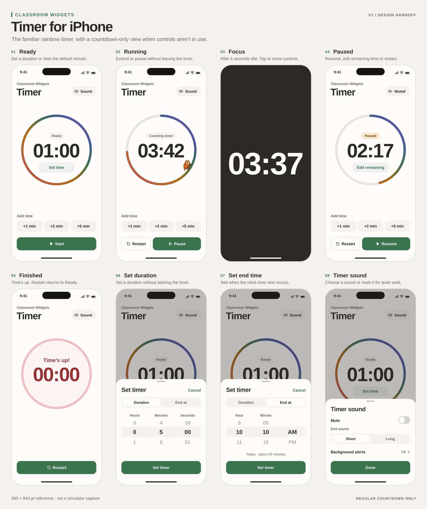

# iPhone timer design

The teacher should see how long is left first, what state the timer is in
second, and the next action third. Keep Classroom Widgets’ rainbow ring and
runner; move the main controls within thumb reach. This is the regular
single timer, not a new widget browser. Floating over other apps / Picture in
Picture is a separate follow-up; don’t ship a placeholder button for it.

## Screen contract

| State | Face | Primary action | Other actions |
| --- | --- | --- | --- |
| Ready | `01:00` on first launch, full ring, **Ready** | **Start** | **Set time**, **+1 min**, **+2 min**, **+5 min**, **Sound** |
| Running | Remaining time, shrinking ring, **Counting down** | **Pause** | **Restart**, quick adds, **Sound** |
| Running · Focus | Enlarged countdown, rainbow ring and hamster | Tap anywhere to show controls | None; countdown keeps running |
| Paused | Frozen time and ring, **Paused** | **Resume** | **Edit remaining**, **Restart**, quick adds, **Sound** |
| Finished | `00:00`, rose face, **Time’s up!** | **Restart** | **Sound**; no quick adds |

- **Start** uses the ready duration; **Resume** uses the remaining duration.
  **Restart** restores the set duration and returns to Ready without starting
  again. It also stops any end sound. Keep **Pause** and **Resume** in the same
  place, with **Restart** secondary until the timer finishes.
- **+1 / +2 / +5 min** update the duration in Ready and extend remaining time
  in Running or Paused without changing the state. As in the web timer, a
  quick add also increases the duration restored by Restart. Editing the
  remaining time explicitly in Paused does not change that restart duration.
- **99:59:59** is the maximum for both remaining time and the duration
  restored by Restart. Disable any quick add that would push either value
  over the cap; show **Max timer: 99:59:59** when an option is disabled.
  Don’t clamp: a button marked **+1 min** either adds a full minute or is
  unavailable. An addition that lands exactly on the cap is allowed.
- **Set time** opens a native sheet with a **Duration / End at** selector.
  Duration is an hours/minutes/seconds wheel (hours 0–99; minutes and
  seconds 0–59). Seed it from the displayed duration. **Set timer** applies the
  draft and returns to Ready; it never starts the countdown. Disable it at
  zero. **Cancel** and swipe-to-dismiss leave the timer unchanged.
- **End at** uses the next occurrence of the selected local clock time, in
  five-minute steps. Default to the next half hour. Label the preview
  **Today** or **Tomorrow** plus the approximate duration; re-evaluate the
  interval when the teacher taps **Set timer**. As in the web timer, this
  action sets a countdown duration, not an alarm scheduled for that clock time.
  **Edit remaining** reuses only the Duration editor and returns to Paused.
- **Sound** opens a small sheet with a **Mute** toggle and **Short / Long**
  selection. Default to Short with mute off; keep the choice when toggling
  mute. Changes apply immediately; **Done** closes the sheet. The button reads
  **Muted** when muted. Muting cuts off a sound that’s already playing.

## Expiry on the Lock Screen or in another app

- With notifications allowed, schedule one [local notification] for the
  current deadline. It says **Time’s up!** and can appear on the Lock Screen
  or over another app, subject to iOS notification settings and Focus.
  **Background alerts** in the Sound sheet requests permission on tap;
  subsequent taps open iOS notification settings. Declining does not stop
  the timer.
- If the app is foregrounded at zero, use the in-app finish screen and
  selected Short or Long sound, not a second system banner. When locked or
  backgrounded, the alert uses the standard iOS notification sound instead.
  **Mute** makes both paths silent but leaves the notification text intact.
- Replace the pending alert when the deadline or mute setting changes;
  cancel it on Pause or Restart. On return after zero, show **Time’s up!**
  without replaying audio or posting another alert, whether the notification
  was delivered, silenced by iOS, or not authorized.

## Full-screen Focus

- After **Start** or **Resume**, show the full controls for five seconds.
  After five seconds without interaction, hide the controls, header and
  status bar. Keep the countdown, rainbow ring and hamster visible and
  moving as usual (respect Reduce Motion). Focus is only a presentation
  of Running: do not change the deadline or stop the countdown.
- Center and enlarge the same timer face, keeping the current light or
  dark appearance. Use a 340 pt dial including the track on the reference
  phone, bounded by the safe area with at least a 24 pt side inset. Let iOS
  handle its home indicator. On first entry only, briefly show
  **Tap to show controls** beneath the dial.
- A tap anywhere restores the regular Running screen, without pausing or
  triggering the revealed control. Restart the five-second delay after
  each interaction, after a sheet closes, or on foreground return. Never
  auto-hide while a sheet is open or assistive navigation is active.
  Reduce Motion replaces any transition with an immediate change.
- At zero, return to the regular **Time’s up!** screen. Ready and Paused
  always show their controls. A countdown that finishes within the delay
  never enters Focus.

## SwiftUI layout

The references are designs at 390 × 844 pt, not Simulator
screenshots. Use the iOS status bar, home indicator, native sheet and
system typography. Do not draw the device chrome in the app.

| Element | Reference at 390 pt |
| --- | --- |
| Page | 24 pt side margins; 15 pt product name and 42 pt bold title |
| Dial | 304 pt diameter including the 10 pt track; centered between header and controls |
| Time | 84 pt system bold with tabular digits; stable `MM:SS` below an hour, `HH:MM:SS` otherwise; fit the latter to about 56 pt |
| State | 14 pt semibold text on a small pill; 23 pt finish copy instead of a pill |
| Controls | 56 pt primary / restart row, 48 pt quick add row, 44 pt or larger edit and sound controls |
| Bottom | Place the action row 14 pt above the bottom safe area; use 24 pt between the quick add and action rows |

The arc has a fixed diagonal gradient and shrinks from the far end toward
the top. It represents
remaining time as a fraction of the current run, not wall-clock time. Use
the existing hamster art for the runner; keep it off the digits and hide or
freeze it with Reduce Motion. Do not shake or flash the screen on finish.

Use the table below for iOS color roles. It draws from the [shared color
tokens](../packages/shared/constants/colors.ts) without inheriting the web
style assignments. In particular, the light primary button uses Sage 600
by default for 5.56:1 contrast with white text; Sage 500 yields 3.90:1.

| Role | Light | Dark |
| --- | --- | --- |
| Canvas / neutral controls | `#FDFCFB` / `#F5F3F0` | `#2D2926` / `#3D3835` |
| Text / secondary text | `#2D2926` / `#6B635A` | `#FDFCFB` / `#D6D2CC` |
| Primary button / label | `#39744C` / white | `#8FBBA0` / `#1A3323` |
| Track | `#E8E5E0` | `#514B44` |
| Paused text / fill | `#613D0A` / `#F9E8CC` | `#F2D09E` / `#613D0A` |
| Finished text / fill | `#963232` / `#FDF4F4` | `#EFC0C0` / `#3F1414` |

Dial gradient from bottom left to top right (light): `#B84040`,
`#B86538`, `#AE6C13`, `#39744C`, `#4759A0`, `#7657A0`.
Use lighter versions against the dark track. Text, not color or animation,
communicates the state. Cap the dial at the available content width and scale
its digits with it. For compact height or accessibility text sizes, let the
screen scroll and controls stack; move the state label or editor action below
the dial if needed. VoiceOver reads the status and a single time value
(e.g. “3 minutes, 42 seconds remaining”); don’t announce every tick. Announce
“Time’s up!” once. Give the quick adds labels such as “Add 1 minute.”

## Simulator review

1. Start the default minute, extend it while running, pause, edit, resume,
   then restart. Confirm edits and quick adds affect restart as specified.
2. Set a duration, then set an end time that has already passed today.
   Confirm the Tomorrow preview, unchanged timer on cancel, and separate Start.
3. Finish a short countdown, including one with sound muted. Check no time goes
   negative, and reopening the app derives the remaining time from the stored
   deadline rather than the number of UI ticks.
4. Check the narrowest supported iPhone, dark appearance, accessibility text
   sizes, VoiceOver and Reduce Motion.
5. Leave a running timer untouched for five seconds. Verify the countdown,
   ring and hamster stay visible while controls hide. Tap to bring controls
   back without pausing. Verify a sheet and VoiceOver prevent the automatic
   transition, and zero exits Focus to **Time’s up!**.
6. On an iPhone with Lock Screen notifications and sounds enabled, start a
   15-second timer and lock it through zero. Expect one notification and one
   system sound. Unlock to **Time’s up!** with no replay. Repeat muted
   (notification only), with permission denied (finish on reopen only), and
   with the app backgrounded in another app. Extend the deadline in a fresh
   run and confirm the earlier alert does not fire.
7. Set `99:58:59`: **+1 min** is available and reaches `99:59:59`;
   **+2 min** and **+5 min** are disabled. At the cap all three are disabled,
   including while running after the remaining time drops (Restart is still
   at the cap). Confirm the picker can reopen at the exact maximum.

Parity reference: [desktop/web timer view](../packages/teacher/src/features/widgets/timer/Timer.tsx),
[countdown state](../packages/teacher/src/features/widgets/timer/hooks/useTimerCountdown.ts),
and [clock-time calculation](../packages/teacher/src/features/widgets/timer/clockTime.ts).

[local notification]: https://developer.apple.com/documentation/usernotifications/scheduling-a-notification-locally-from-your-app
